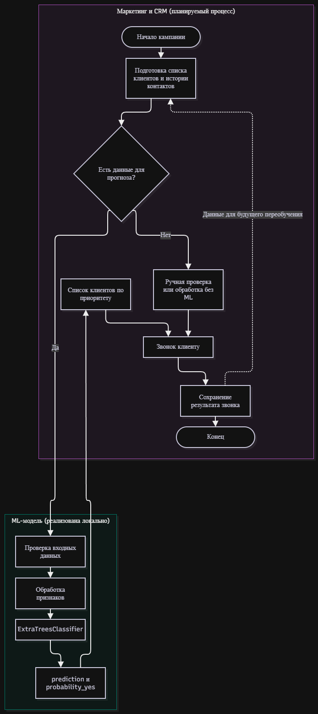
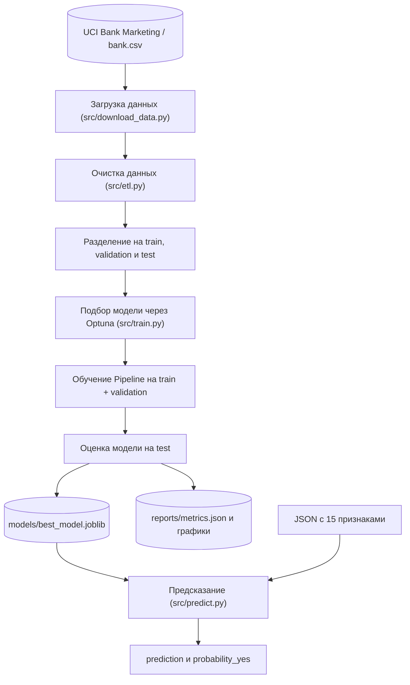
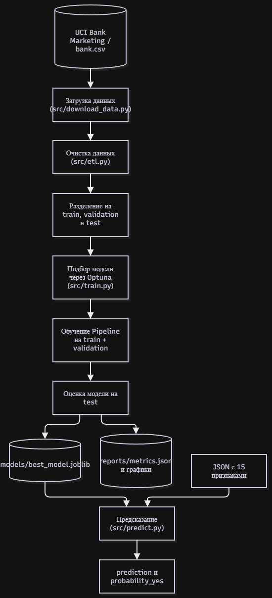

# Роль ML-модели в банковской маркетинговой кампании

Проект - automl_bank_project
Модель - ExtraTreesClassifier, прогноз отклика на предложение депозита
Описание модели - [model_card.md](model_card.md)

## 1. Схема бизнес-процесса

Это пример того, как модель можно использовать в банке. В текущем проекте интеграции с CRM нет, предсказание запускается локально через src/predict.py.

```mermaid
flowchart TD
    subgraph bank["Маркетинг и CRM (планируемый процесс)"]
        direction TB
        start([Начало кампании])
        data["Подготовка списка клиентов и истории контактов"]
        data_check{"Есть данные для прогноза?"}
        manual["Ручная проверка или обработка без ML"]
        plan["Список клиентов по приоритету"]
        call["Звонок клиенту"]
        fact["Сохранение результата звонка"]
        finish([Конец])
    end

    subgraph ml["ML-модель (реализована локально)"]
        direction TB
        validate["Проверка входных данных"]
        transform["Обработка признаков"]
        score["ExtraTreesClassifier"]
        output["prediction и probability_yes"]
    end

    start --> data --> data_check
    data_check -- "Нет" --> manual --> call
    data_check -- "Да" --> validate --> transform --> score --> output --> plan --> call
    call --> fact --> finish
    fact -. "Данные для будущего переобучения" .-> data
```



Пунктирная стрелка показывает возможное использование результатов звонков для будущего переобучения. Сейчас автоматического переобучения в проекте нет.

## 2. Какую задачу решает модель

Модель определяет, насколько клиент может быть заинтересован в срочном депозите. Это бинарная классификация с двумя вариантами ответа: 1 - положительный отклик, 0 - отрицательный.

В бизнес-процессе модель находится после подготовки данных и до составления списка звонков. Она помогает расставить приоритеты, но не принимает решения вместо сотрудника.

## 3. Почему здесь используется ML

Отклик зависит сразу от нескольких факторов - возраста клиента, финансовых данных, истории контактов, времени и способа связи. Простые правила не всегда учитывают сочетания этих признаков.

ML позволяет обучиться на прошлых результатах кампаний и для каждого клиента получить скор. Но само по себе это не гарантирует рост продаж. На тестовых данных F1-score составляет 0.3348, поэтому пользу нужно отдельно проверять на реальных кампаниях.

## 4. Данные на входе

Модель использует 15 признаков.

- Данные клиента - age, job, marital, education
- Финансовые данные - default, balance, housing, loan
- История контактов - contact, day, month, campaign, pdays, previous, poutcome

Данные взяты из [UCI Bank Marketing](https://archive.ics.uci.edu/dataset/222/bank+marketing). Для работы в реальном банке нужны аналогичные поля из CRM, доступные до звонка.

Признак duration не используется, потому что длительность звонка заранее неизвестна. Поле y содержит правильный ответ только для обучения и проверки качества.

## 5. Как используется результат

Функция predict_client() возвращает прогноз класса и скор положительного отклика.

```json
{
  "prediction": 1,
  "probability_yes": 0.73
}
```

Это пример структуры ответа. prediction получается из probability_yes при пороге 0.5.

В предлагаемом бизнес-процессе клиентов можно сортировать по probability_yes и составлять очередь звонков с учётом правил кампании. После контакта менеджер фиксирует результат. Важно, что скор не калиброван, поэтому его нельзя считать точной вероятностью оформления депозита.

## 6. Техническая схема проекта

Ниже показано, что уже реализовано в репозитории.





- src/download_data.py загружает bank.csv.
- src/etl.py очищает данные и исключает duration.
- src/train.py подбирает параметры через Optuna и обучает модель.
- src/model_io.py сохраняет и загружает модель, src/reporting.py создаёт отчёты.
- src/predict.py принимает JSON и возвращает прогноз.

В проекте пока нет REST API, подключения к CRM, управления обзвоном и автоматического переобучения. Для внедрения в банк эти части потребуется разработать отдельно.

## 7. Ссылки на проект

- [Описание модели](model_card.md)
- [README](README.md)
- [Обучение](src/train.py)
- [Подготовка данных](src/etl.py)
- [Предсказание](src/predict.py)
- [Метрики](reports/metrics.json)
