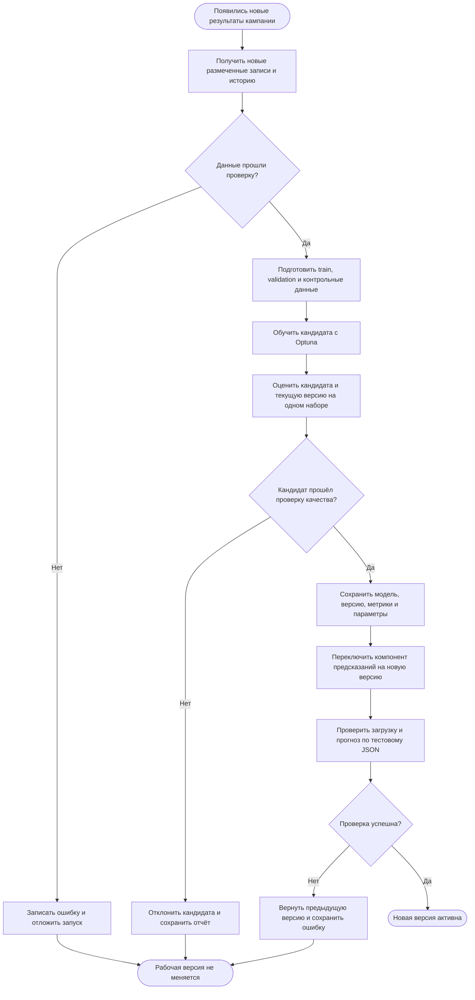
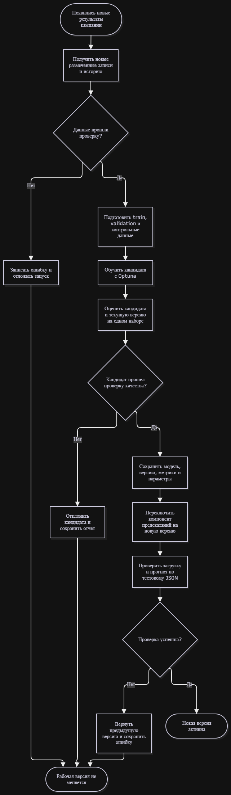

# Автоматическое переобучение ML-модели

Проект - automl_bank_project
Модель - прогноз отклика клиента на банковский депозит
Связанная документация - [model_card.md](model_card.md), [model_bpmn.md](model_bpmn.md)

## 1. Схема процесса

Схема показывает, как можно организовать автоматическое переобучение после появления новых результатов маркетинговых кампаний. Это проектируемый процесс. Сейчас в репозитории есть обучение и оценка модели, но нет автоматического запуска по новым данным, публикации версий и отката.

## 2. Этапы переобучения

| Этап | Что происходит | Результат |
|---|---|---|
| 1. Триггер | После завершения кампании система обнаруживает новые контакты с известным результатом `y`. Проверка может запускаться по расписанию, например раз в месяц | Запрос на переобучение и новая партия записей |
| 2. Получение данных | Новые записи объединяются с подходящими историческими данными. Сохраняется версия исходного набора | Набор данных для следующего запуска |
| 3. Проверка данных | Проверяются 15 необходимых признаков, метка `y`, пустые значения, дубликаты и наличие обоих классов. Признак `duration` исключается | Подготовленные данные или остановка с указанием ошибки |
| 4. Разделение данных | Отдельно выделяются данные для обучения, валидации и контрольной проверки. Контрольные записи не используются при подборе параметров | Train, validation и независимый контрольный набор |
| 5. Обучение | Через Optuna подбираются алгоритм и параметры. Обучается новый Pipeline с обработкой признаков | Модель-кандидат, ещё не заменяющая рабочую |
| 6. Проверка качества | Кандидат и текущая утверждённая модель проверяются на одном контрольном наборе. Рассчитываются F1-score, Precision, Recall и ROC-AUC | Метрики двух версий и результат сравнения |
| 7. Решение | Если кандидат прошёл проверки, его допускают к публикации. Иначе результаты сохраняются, а действующая версия остаётся без изменений | Разрешение на выпуск либо отклонение кандидата |
| 8. Сохранение версии | Сохраняются модель, номер версии, метрики, параметры и версия данных. Запись об эксперименте может храниться в MLflow | Зарегистрированная версия, доступная для деплоя |
| 9. Деплой | Новая версия подключается к компоненту предсказаний вместо старой. Предыдущая версия сохраняется для отката | Новая активная версия модели |
| 10. Проверка после деплоя | Проверяется загрузка модели и предсказание по тестовому JSON с 15 признаками | Подтверждение успешного выпуска либо сигнал на откат |
| 11. Откат при ошибке | При сбое возвращается предыдущая версия, ошибка записывается в журнал | Восстановленная рабочая модель и отчёт об ошибке |

## 3. Когда новая версия допускается к публикации

Предлагаемые условия для учебного проекта:

- В данных есть обязательные признаки и корректная разметка `y` (0 или 1). Нет критических ошибок подготовки.
- На одинаковом контрольном наборе F1-score кандидата не ниже F1-score действующей версии.
- ROC-AUC кандидата не ниже ROC-AUC действующей версии более чем на 0.02.
- Сохранённый Pipeline успешно загружается и возвращает `prediction` и `probability_yes` для корректной входной записи.

Если хотя бы одна проверка не пройдена, новую модель не публикуем. Сохраняем метрики и причину отказа, затем ждём следующей партии данных или исправления ошибки. Для первого выпуска, когда рабочей версии ещё нет, нужен отдельный допуск по согласованным метрикам и проверке входных данных.

Порог 0.02 для ROC-AUC выбран как пример правила допуска. Сейчас такие пороги в коде не настроены. Значения F1 = 0.3348 и ROC-AUC = 0.7154 из [reports/metrics.json](reports/metrics.json) относятся к старой тестовой выборке. Их нельзя напрямую сравнивать с оценкой кандидата на других данных: обе модели нужно проверить на одном и том же независимом наборе.

## 4. Что уже есть в проекте

- `src/etl.py` - загрузка таблицы, очистка, выделение признаков и целевого столбца.
- `src/train.py` - обучение Pipeline и подбор модели через Optuna.
- `src/evaluate.py` и `src/reporting.py` - оценка качества и сохранение метрик.
- `src/model_io.py` - сохранение и загрузка модели через Joblib.
- `src/predict.py` - получение предсказания по JSON.
- MLflow - запись параметров, метрик и файлов эксперимента.
- GitLab CI/CD - линтеры, тесты и сборка Docker-образа.

## 5. Что потребуется для автоматизации

Сейчас `src/train.py` после обучения сразу записывает результат в `models/best_model.joblib`. При автоматическом переобучении так делать нельзя: новый кандидат сначала должен пройти сравнение, а старая версия должна оставаться доступной. Поэтому потребуется отдельное хранение кандидатов и механизм выбора активной версии.

Также нужно будет добавить получение новых размеченных данных, триггер запуска, проверки перед публикацией, реестр версий, автоматический деплой и откат. Текущий `src/monitor.py` собирает загрузку CPU и памяти, а не качество прогнозов. Docker в проекте запускает обучение, а не постоянно работающий сервис предсказаний.

Таким образом, схема описывает целевой процесс обновления модели. Существующие части проекта можно использовать при его реализации, но само автоматическое переобучение в третьем домашнем задании не разрабатывается.
